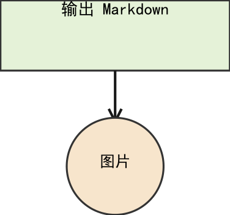
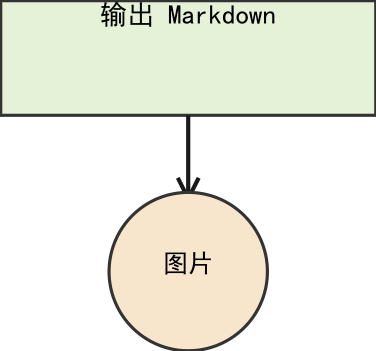

# PDF2MD 示例文档

---


## 第1章 入门示例


—— pdf2md工具演示样例（自创内容，无版权问题）

pdf2md是一个把PDF图书转换成单篇Markdown文

档的工具，并把书中的所有插图抽取到images/ 文件夹。本章介绍

它的基本用途。


### 1.1这是什么


它读取PDF的目录结构，自动划分章节，并把矢量绘图渲染为图片。对

于等宽字体排版的代码，它会识别为代码块并加围栏。


````python
# example.py  -- a tiny demo
def greet(name):
    return f"Hello, {name}!"
if __name__ == '__main__':
    print(greet('pdf2md'))
````


### 1.2工作流程


下图展示了从输入PDF到输出Markdown的处理流程。


图：PDF2MD处理流程（矢量绘图示例）





上面的流程图由矢量路径（矩形、直线、圆）构成，而不是位图。pdf2m

d会把它们聚类后渲染为一张PNG，写进images/ 并插入

Markdown。

---

## 第2章 矢量图与代码


本章进一步演示矢量图提取与代码块识别两个核心能力。


### 2.1矢量图提取


很多技术书用矢量图形讲解概念。pdf2md会保留这些图形，而不是把

它们当作文字丢弃。





### 2.2代码块识别


````python
# tokenizer demo
tokens = 'PDF to Markdown'.split()
for t in tokens:
    print(len(t), t)
````
